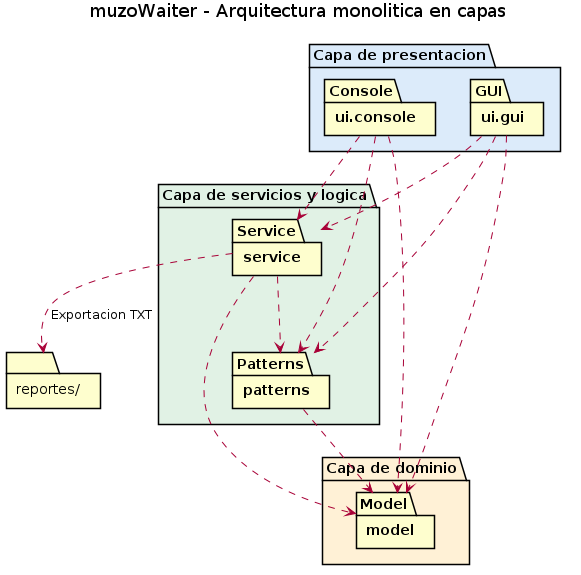

# Muzo Waiter

Sistema de gestión de pedidos para cafeterías y restaurantes,
desarrollado en Java 21 mediante patrones de diseño y una
arquitectura monolítica organizada en capas.

## Descripción del proyecto

Propuesta 3: Cafetería o restaurante.

muzoWaiter permite gestionar productos personalizables, combos,
pedidos, promociones, notificaciones y operaciones de caja.

El sistema dispone de una interfaz de consola y una interfaz
gráfica Swing que reutilizan el mismo núcleo de negocio.

## Funcionalidades

- Creación de pedidos.
- Platos y bebidas con adiciones opcionales.
- Construcción de combos paso a paso.
- Consulta y seguimiento de pedidos.
- Notificaciones a cocina, caja y mesero.
- Promociones por horario y día.
- Registro de pagos.
- Validación de cobros duplicados durante la ejecución.
- Cierre de caja y exportación de reportes TXT.
- Interfaz gráfica Swing.
- Interfaz de consola.

## Tecnologías

- Java 21
- Java Swing
- Apache Maven
- JUnit 5
- PlantUML
- Git y GitHub

## Arquitectura

El sistema utiliza una arquitectura monolítica organizada en capas flexibles.

| Capa | Responsabilidad |
|---|---|
| Presentación | Interacción mediante consola y Swing |
| Servicios | Gestión de pedidos, promociones y caja |
| Dominio | Entidades y reglas del negocio |
| Patrones | Componentes reutilizables de diseño |

## Patrones de diseño

| Patrón | Categoría | Aplicación |
|---|---|---|
| Decorator | Estructural | Adiciones de productos |
| Observer | Comportamiento | Notificaciones de pedidos |
| Strategy | Comportamiento | Promociones intercambiables |
| Builder | Creacional | Construcción de combos |
| Singleton | Creacional | Instancia de caja registradora |

## Instalación

Requisitos: JDK 21, Maven y Git.

    git clone https://github.com/Bennytow/muzoWaiter.git
    cd muzoWaiter
    mvn clean package

## Ejecutar interfaz gráfica

    java -jar target/muzoWaiter-1.0.0.jar

## Ejecutar interfaz de consola

    java -cp target/classes com.muzowaiter.ui.console.ConsolaApp

## Pruebas unitarias

    mvn clean test

Las pruebas verifican el comportamiento de los cinco patrones
de diseño y diferentes reglas de negocio.

## Limitaciones

- Los pedidos y pagos activos se mantienen en memoria.
- Los reportes de cierre se exportan a archivos locales.
- No se utiliza una base de datos externa.
- La consola y Swing no sincronizan datos entre procesos.
- No existe autenticación diferenciada por roles.
- El menú de productos está definido en el código.

## Repositorio

https://github.com/Bennytow/muzoWaiter

## Estilo arquitectónico

[Arquitectura monolítica en capas](docs/ARQUITECTURA.md)
