# Diagramas UML de muzoWaiter

Documentacion del sistema y sus patrones de diseño.

## 01 Casos De Uso

[Codigo PlantUML](01-casos-de-uso.puml)

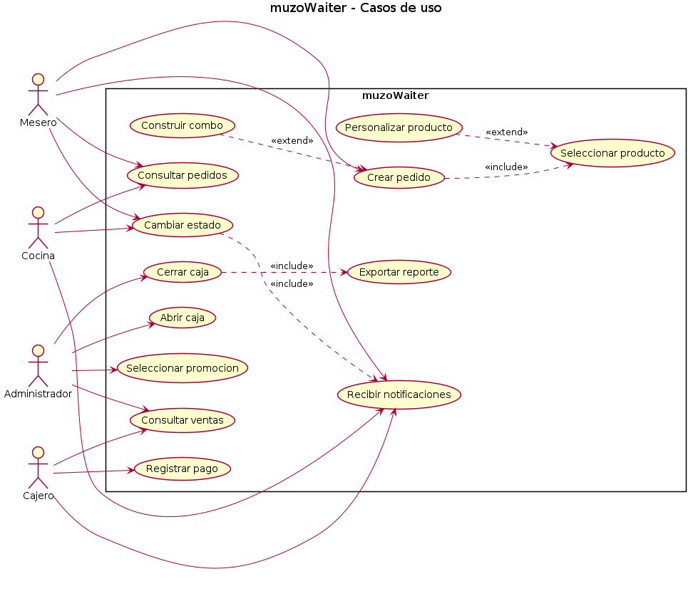

## 02 Clases General

[Codigo PlantUML](02-clases-general.puml)

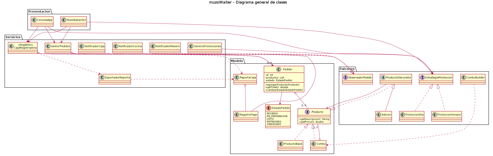

## 03 Decorator

[Codigo PlantUML](03-decorator.puml)

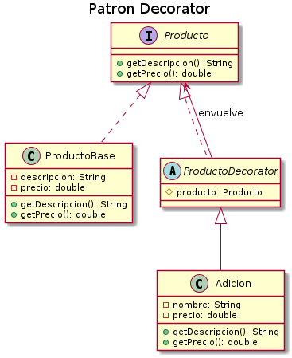

## 04 Observer

[Codigo PlantUML](04-observer.puml)

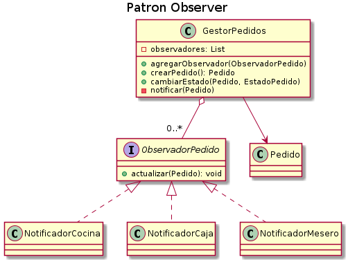

## 05 Strategy

[Codigo PlantUML](05-strategy.puml)

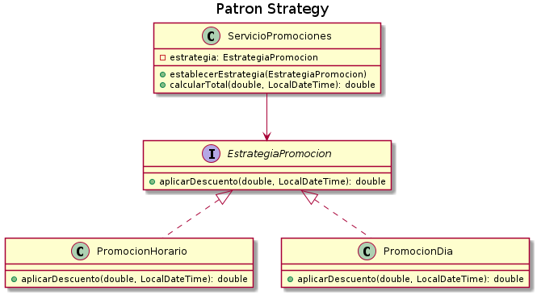

## 06 Builder

[Codigo PlantUML](06-builder.puml)

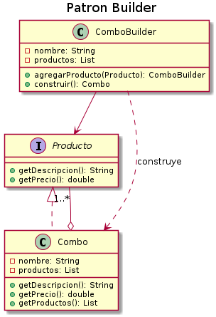

## 07 Singleton

[Codigo PlantUML](07-singleton.puml)

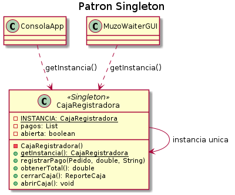

## 08 Secuencia Pedido

[Codigo PlantUML](08-secuencia-pedido.puml)

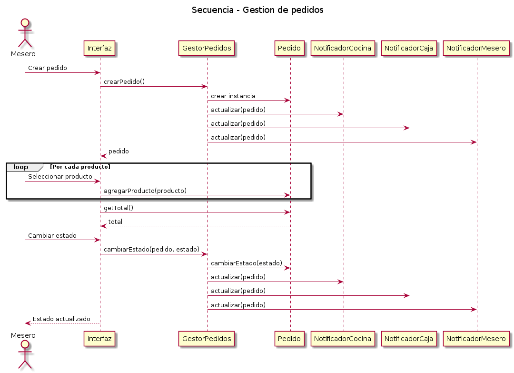

## 09 Secuencia Caja

[Codigo PlantUML](09-secuencia-caja.puml)

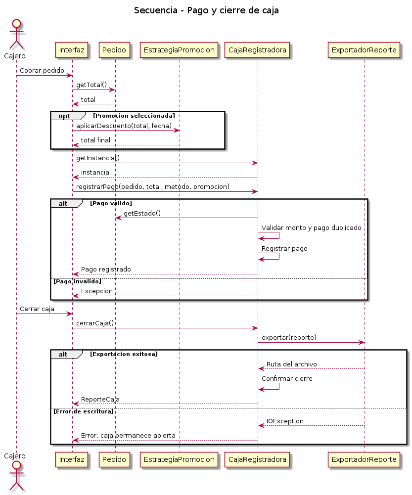

## 10 Actividades

[Codigo PlantUML](10-actividades.puml)

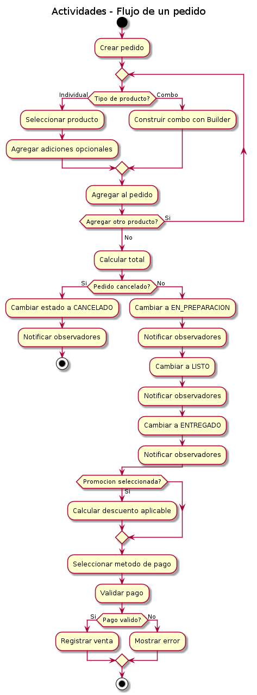

## 11 Arquitectura Paquetes

[Codigo PlantUML](11-arquitectura-paquetes.puml)

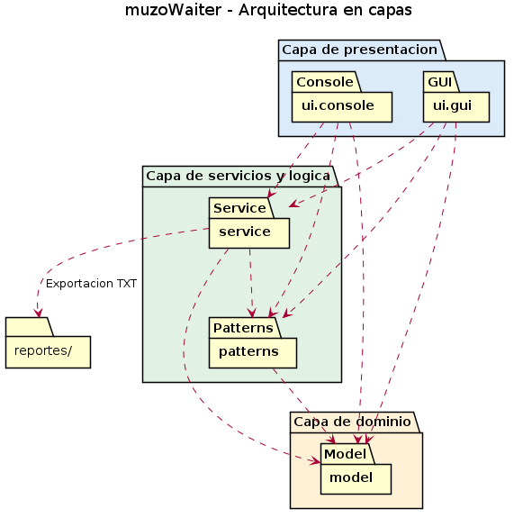
